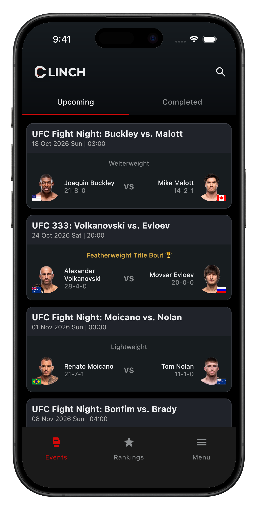
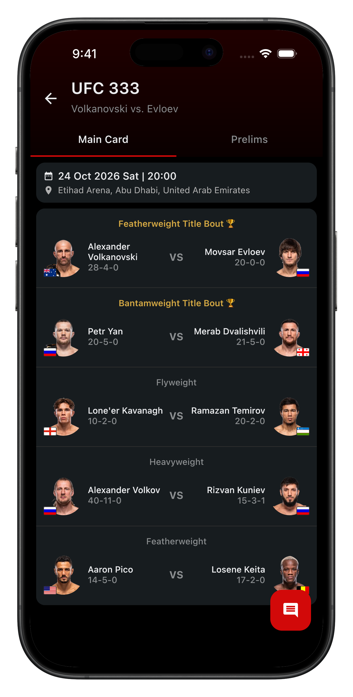
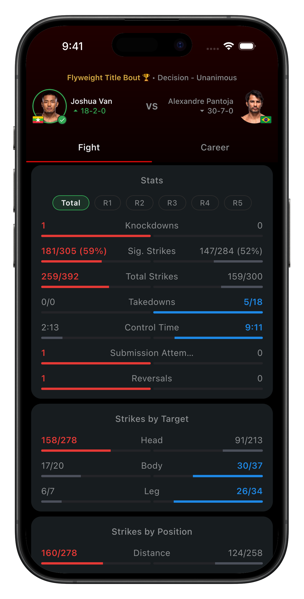
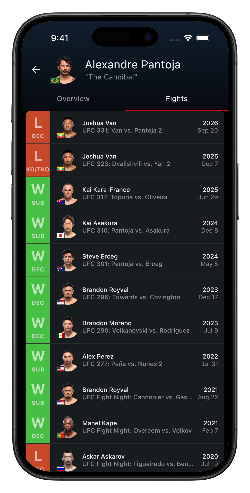
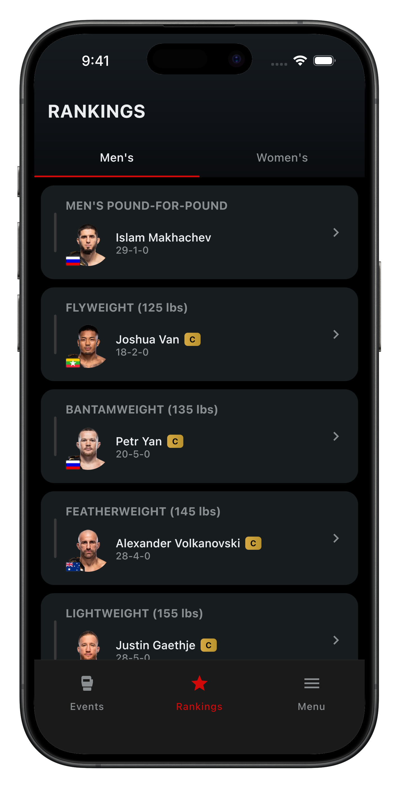
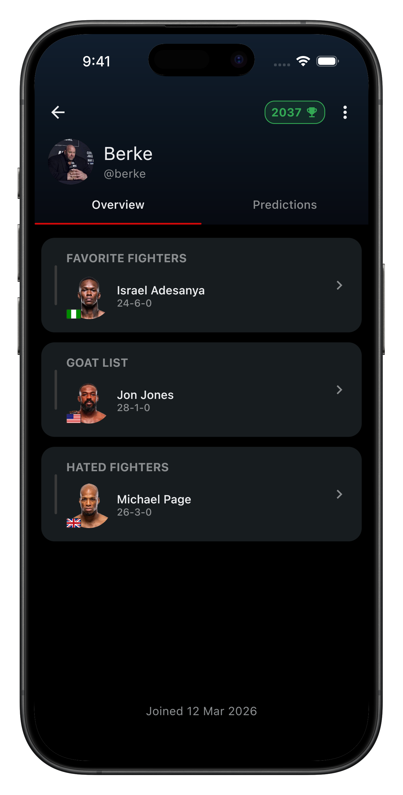

# 🥊 Clinch - MMA Statistics & Event Tracker

Clinch is a comprehensive data and engagement platform designed for mixed martial arts enthusiasts. Follow every event, explore detailed fight and fighter stats, and compete with other fans. Built with **Kotlin Multiplatform** for Android and iOS.

 

 

## 📲 Download

&nbsp;&nbsp;

## ✨ Key Features

* **Events & Fights:** Upcoming and past events with round-by-round fight stats.
* **Fighter Stats:** Fighter profiles, radar charts compared with other fighters, and official rankings.
* **Predictions & Leaderboard:** Predict the winners and climb the weekly and all-time leaderboards.
* **Event Comments:** Discuss events with other fans in real-time comments.
* **Fight Reminders:** Get notified before fights start.
* **Profiles:** Build your own GOAT list, favorite fighters and hated fighters.

## 📱 Screenshots

  
  
  
   
  
  
  

## 🛠️ Tech Stack

* **UI Framework:** Jetpack Compose & Compose Multiplatform
* **Architecture:** Clean Architecture (MVI pattern)
* **Local Database:** Room Database (KMP implementation)
* **Backend & Authentication:** Supabase (PostgreSQL, Auth, Storage, Realtime)
* **Push Notifications:** Firebase Cloud Messaging
* **Dependency Injection:** Koin
* **Asynchronous Operations:** Kotlin Coroutines & Flows
* **Image Loading:** Coil 3
* **Networking:** Ktor

## 📬 Contact

Please contact us with any questions, support requests, or feedback: **[clinchapp0@gmail.com](mailto:clinchapp0@gmail.com)**
