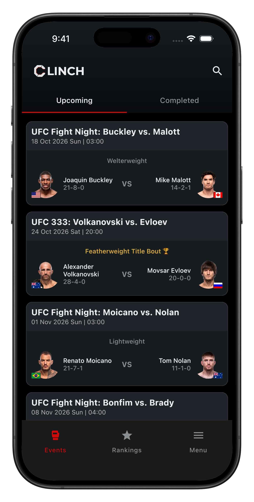
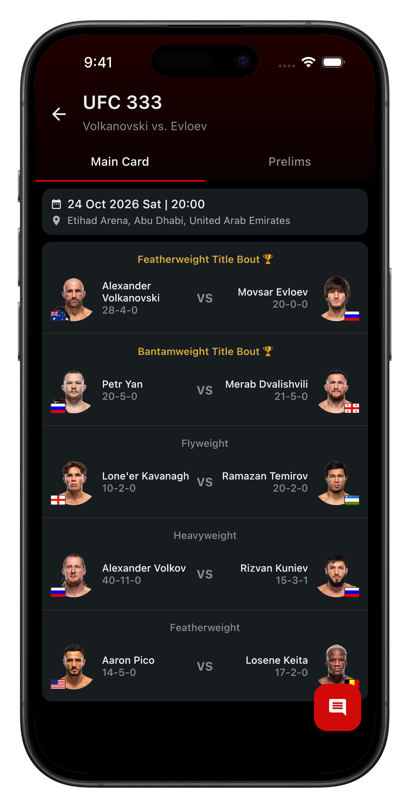
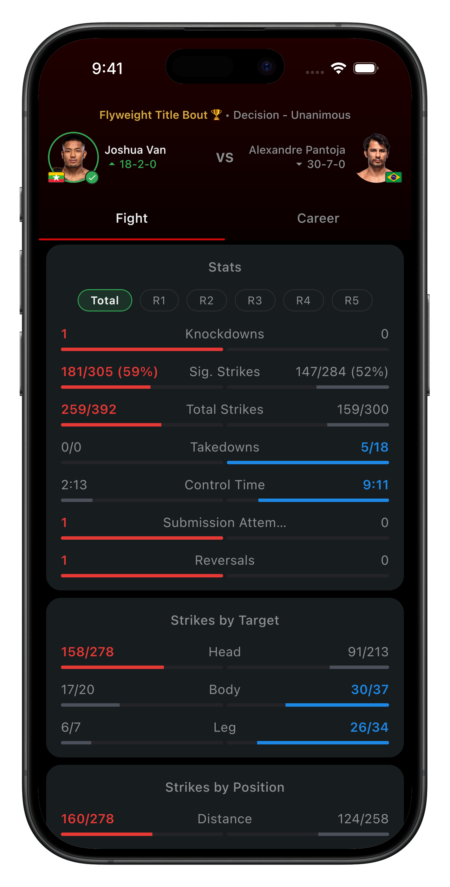
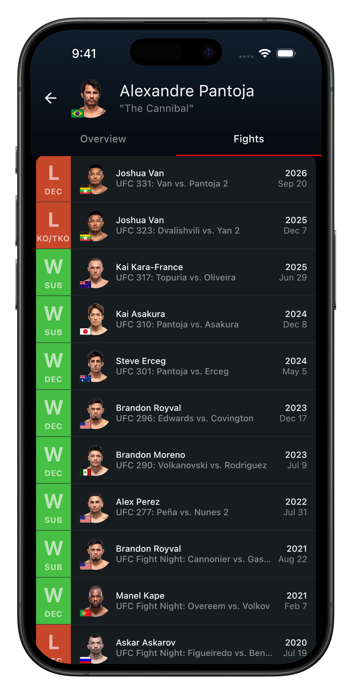
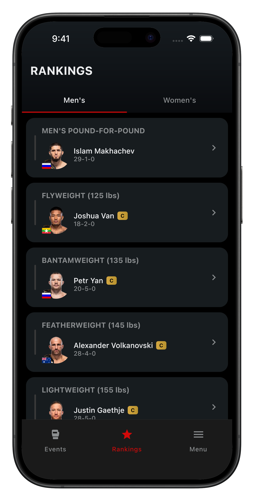
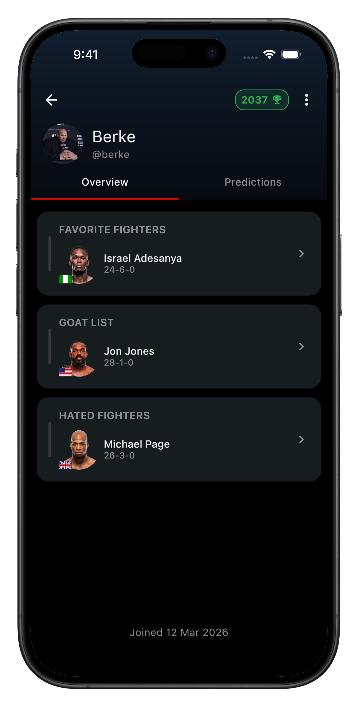

# 🥊 Clinch - MMA Statistics & Event Tracker

A modern, cross-platform Mixed Martial Arts application built with **Kotlin Multiplatform (KMP)** for Android and iOS. Stay up to date with the latest MMA events, analyze fight statistics, create predictions, and compete on the global leaderboard!

 

 

## 📲 Download

&nbsp;&nbsp;

## ✨ Key Features

* **Cross-Platform Experience:** Built natively for both Android and iOS, sharing business logic and UI components via Compose Multiplatform.
* **Events:** Browse upcoming events and past events by year. Each event shows its main card and prelims, date, venue and a live indicator while it's happening.
* **Event Comments (New):** Discuss every event with other fans in a real-time chat. New comments appear instantly, and inappropriate comments can be reported.
* **Fight Details:** See both fighters side by side, the fight result and method, round format, weight class and referee. Completed fights include round-by-round stats: knockdowns, significant and total strikes, takedowns, control time, plus strikes by target and by position.
* **Career Comparison:** Compare the two fighters' career stats in the "Career" tab, including a radar chart of striking, takedown and submission attempt averages, and side-by-side finishing, striking and grappling stats.
* **Fighter Profiles:** Each fighter has a record, physical info (height, reach, age, weight class), a radar chart, KO/TKO and submission rates, and a full fight history.
* **Rankings:** Official rankings for every men's and women's weight class, including champions.
* **Search:** Find any fighter or user by name.
* **Fight Predictions:** Predict the winner before the fight starts. Points are calculated from real odds, shown in decimal or American format.
* **Leaderboard:** Compete with other MMA fans on weekly and all-time leaderboards, and view other users' profiles and prediction history.
* **Personalized Profiles:** Sign in with Google or Apple, set your avatar and username, and curate your "Goat List", "Favorite Fighters" and "Hated Fighters".
* **Fight Reminders:** Get a reminder right before a fight starts, as a regular notification or a full-screen alarm on Android, and get notified when results are announced.
* **Safety Controls:** Report or block users, and manage your blocked accounts from the settings.
* **Customization & Localization:** Light and Dark themes, metric or imperial measurements, decimal or American odds, fully localized in English and Turkish.

## 📱 Screenshots

  
  
  
   
  
  
  

## 🛠️ Tech Stack

* **UI Framework:** Jetpack Compose & Compose Multiplatform
* **Architecture:** Clean Architecture (MVI pattern)
* **Local Database:** Room Database (KMP implementation)
* **Backend & Authentication:** Supabase (PostgreSQL, Auth, Storage, Realtime)
* **Push Notifications:** Firebase Cloud Messaging
* **Dependency Injection:** Koin
* **Asynchronous Operations:** Kotlin Coroutines & Flows
* **Image Loading:** Coil 3
* **Networking:** Ktor

## 📬 Contact

Please contact us with any questions, support requests, or feedback: **[clinchapp0@gmail.com](mailto:clinchapp0@gmail.com)**
